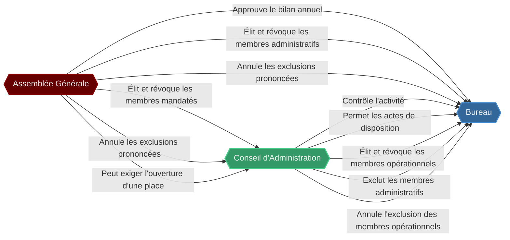
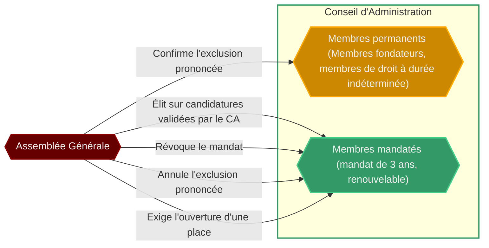
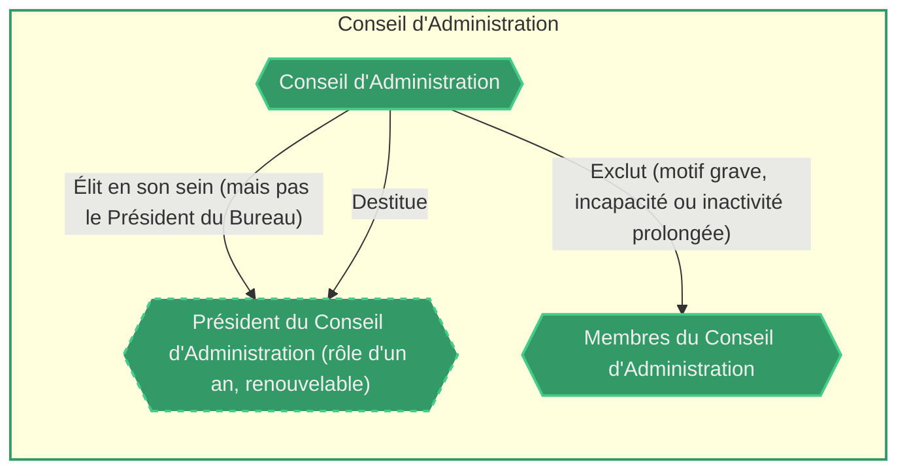
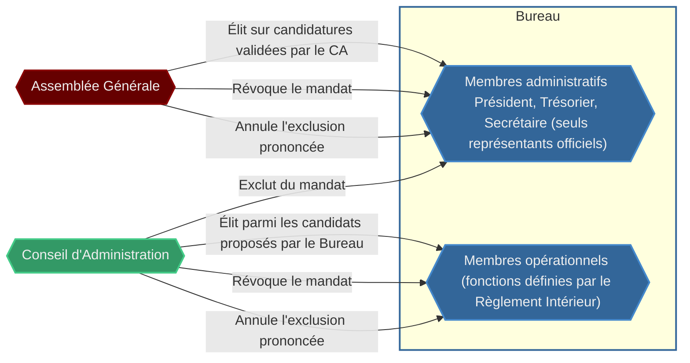
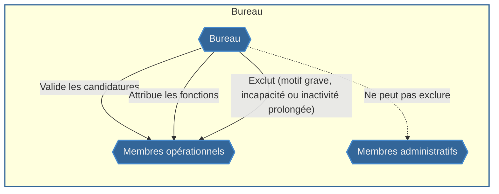
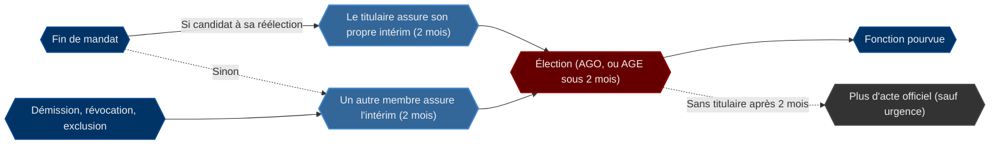
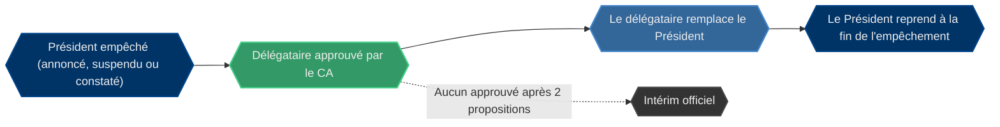
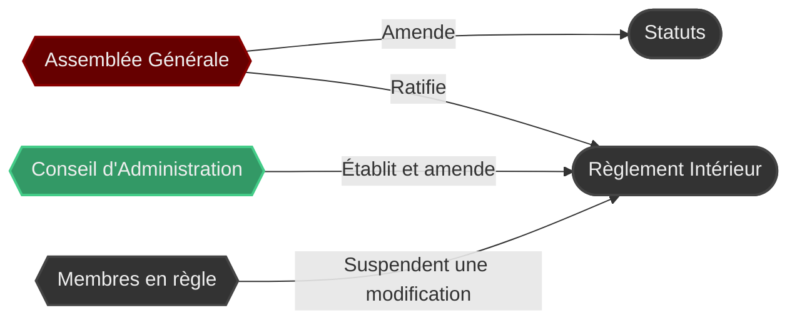

# Diagramme des instances de l'Association

<!-- Les règles de vote, de quorum et de seuils sont détaillées dans [Votes](Votes.md). -->

## Général

## Assemblée Générale

### Assemblée Générale Ordinaire (AGO)

Fonctionnement :
- Elle se tient au moins une fois par an.
- 1/5 des Membres en règle peuvent faire ajouter un ou plusieurs points en fin de séance.

Convocation :
- Le Président du Bureau, ou son remplaçant, la convoque au moins 15 jours avant, avec l'ordre du jour.
- À défaut, le Trésorier la convoque, puis le Président du CA.

### Présidence de l'Assemblée Générale

Président de séance :
- Elle est présidée par le Président du Bureau ou son remplaçant.
- À défaut, par le Président du CA, puis le Secrétaire, puis un membre désigné par les membres présents.

Procès-verbal :
- Le Secrétaire rédige le procès-verbal.
- S'il est absent, préside ou refuse, celui qui préside désigne un autre membre du Bureau ou du CA présent, ou à défaut un autre membre présent.

### Assemblée Générale Extraordinaire (AGE)

Fonctionnement :
- Elle ne traite que les motifs de sa convocation.
- Elle peut se tenir le même jour qu'une AGO.

Convocation sur demande :
- Elle est convoquée sous 30 jours quand elle est demandée par :
  - le CA, par décision ou à la demande de 1/2 de ses membres ;
  - 1/2 des membres du Bureau ;
  - tous les Membres fondateurs ;
  - 1/3 des Membres en règle, ou 1/5 pour examiner une exclusion.

Convocation automatique :
- Sous 2 mois quand le Président du Bureau ou le Trésorier est vacant, ou que le CA tombe sous 3 membres.
- Sous 30 jours pour confirmer l'exclusion d'un Membre fondateur.

### Quorum

- Si le quorum n'est pas atteint, une seconde AG se tient dans les 45 jours, sans quorum.

## Conseil d'Administration

Fonctionnement :
- Sous 3 membres, les décisions du CA sont invalides, sauf la gestion des candidatures nécessaire à le reconstituer.

Exclusion :
- L'exclusion d'un membre du CA est immédiate.
- 1/5 des Membres en règle peuvent demander une AGE pour examiner l'exclusion, que l'AG peut annuler.
- Les Membres fondateurs ne peuvent pas être révoqués. Leur exclusion doit être confirmée par une AGE sous 30 jours, sinon elle est annulée.

## Bureau

Fonctionnement :
- Sous 4 membres, les décisions du Bureau sont invalides, sauf la gestion des candidatures nécessaire à le reconstituer et les actes conservatoires ou urgents du Président.

Membres :
- Conditions d'éligibilité : être Membre en règle, avoir 13 mois d'ancienneté et être bénévole actif.
- Les candidats administratifs sont validés par le CA et élus par l'AG.
- Les candidats opérationnels sont proposés par le Bureau et élus par le CA.
- Le Bureau en place fixe le nombre de places de Membres opérationnels.
- Le CA peut imposer l'ouverture de places de Membres opérationnels.
- Quand le CA a imposé l'ouverture d'une place et refuse tous les candidats proposés, le Bureau en propose d'autres sous 15 jours.
- Si le CA refuse à nouveau, ou si le Bureau ne propose personne dans les délais, le CA peut élire directement un autre candidat éligible pour résoudre le blocage.

## Vacances et intérim

Fin de mandat :
- Le titulaire assure son propre intérim s'il est candidat à sa réélection, ou avec l'approbation du reste de son organe (Bureau ou CA) s'il ne se représente pas.

Sans intérim du titulaire, ou en cas de vacance pour une autre raison :
- Membres administratifs du Bureau :
  - Le Secrétaire remplace le Président ou le Trésorier. Le Président ou le Trésorier remplace le Secrétaire.
  - Le Président et le Trésorier ne se remplacent pas entre eux.
  - À défaut, le CA désigne un de ses membres pour assurer l'intérim.
- Membres opérationnels du Bureau et membres du CA :
  - Ils ne sont pas remplacés : la place reste vacante jusqu'à l'élection, ou est fermée.

## Empêchement du Président

Délégataire :
- Le Président du Bureau choisit son délégataire parmi le Secrétaire et les membres du CA. Le Trésorier ne peut pas l'être, même s'il siège au CA.
- Le délégataire n'a aucun pouvoir avant l'approbation du CA. Dans l'attente, seuls les actes conservatoires ou urgents sont possibles, et le Président du Bureau peut déléguer librement ses tâches hors représentation.

Approbation :
- Le Président du Bureau peut déposer une liste de personnes par ordre de préférence, à l'avance ou à son empêchement. Le CA les examine ensuite dans cet ordre et retient la première approuvée et disponible.
- Si aucune n'est retenue, le Président du Bureau peut en proposer d'autres une seule fois, sous 15 jours. À défaut, l'intérim officiel s'applique.

Constat :
- Si le Président du Bureau ne peut pas annoncer son empêchement, le Secrétaire le constate, ou à défaut le Trésorier, puis le CA confirme.

## Documents

Modification :
- Une modification du RI s'applique 72 heures après sa communication, sauf si 1/4 des Membres en règle en demandent la suspension : le CA statue alors.

Ratification :
- L'AG ratifie le RI à la plus proche assemblée. Ce n'est pas une condition de son application, mais un texte ratifié ne peut plus être suspendu.
